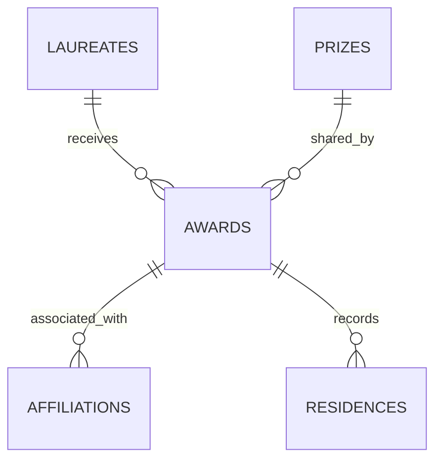

# Архитектура и требования курса

Проект разделён на доменную модель, источники данных, хранилище, анализ, графики и интерфейс. База содержит первичные JSON без потери полей и нормализованные таблицы для анализа. Сайт и API читают одну структуру данных и используют один `AnalyticsService`.

| Требование парного проекта | Реализация |
|---|---|
| 5+ классов | `Entity`, `Laureate`, `GeoPoint`, `Place`, `Award`, `NobelPrize`, `AwardCredit`, `NobelDataset`, `PoliteHTTP`, `SourceClient`, `NobelClient`, `WikidataClient`, `DatabaseRepository`, `IngestionPipeline`, `UpdateLock`, `FilterSpec`, `AnalyticsService` |
| Наследование | `Laureate(Entity)`, `NobelPrize(Award)`, `NobelClient(SourceClient)`, `WikidataClient(SourceClient)` |
| Композиция | `Laureate` содержит `Place` и `AwardCredit`; `AwardCredit` содержит `NobelPrize` и места аффилиаций; pipeline объединяет клиенты и repository |
| База данных | SQLite, внешние ключи, несколько связанных таблиц, SQL JOIN, чтение и запись, атомарное обновление |
| 3+ изменяемых визуализации | 13 основных видов и дополнительный график организаций, общие и локальные настройки |
| 3+ переопределения | `Entity.__eq__`, `Entity.__hash__`, `Entity.__str__`, `GeoPoint.__str__`, `Place.__str__`, `NobelDataset.__len__`, `__iter__`, `__getitem__`; `UpdateLock.__enter__`, `__exit__` |
| Декораторы | Собственный `@timed` с `functools.wraps`; `@st.cache_data`, `@property`, `@classmethod`, `@abstractmethod`, `@lru_cache`; маршруты FastAPI |
| Дополнительный сервер | `api.py`, HTTP JSON, пагинация, валидация, необязательный API-ключ, OpenAPI `/docs` |

Классы применяются в рабочем пути импорта/анализа; они не добавлены только для количества.

`laureates.id` — ID официального источника. `prizes.prize_key` — `nobel:год:код_категории`. `awards.award_key` — ключ премии плюс ID лауреата. У одной премии несколько получателей; у одного получателя может быть несколько премий. `source_pages` сохраняет полные ответы обоих endpoint вместе с `meta` и `links`; `raw_json` в таблицах сохраняет полные записи. `wikidata_entities` хранит сырой ответ по QID и время загрузки. `metadata` хранит версию схемы, контрольную сумму и дату последней установленной версии.

| Файл | Ответственность |
|---|---|
| `nobel/models.py` | Модель, неполные даты, возраст, валидация набора |
| `nobel/sources.py` | Последовательные HTTP-запросы, пагинация, повторы, API-клиенты |
| `nobel/storage.py` | SQLite, нормализация, оригинальные JSON, безопасная замена |
| `nobel/analysis.py` | Фильтры, единицы подсчёта, связи мест и геодезические расстояния |
| `nobel/geography.py` | Происхождение людей/организаций, проверяемый справочник городов |
| `nobel/exports.py` | Пакетный read-only экспорт всех полей JSON |
| `nobel/charts.py` | Графики Plotly и единая палитра |
| `nobel/ui.py`, `app.py` | Карточки, навигация, формы и визуальная иерархия |
| `updater.py` | CLI, блокировка параллельных запусков, последовательность импорта |
| `api.py` | Необязательный HTTP-интерфейс для других приложений |

## Сценарий демонстрации

1. Показать карту и различие числа лауреатов/награждений/премий.
2. Выбрать категорию и страну, сравнить возраст и десятилетия.
3. Найти `Curie`, открыть карточку, показать повторную премию и полную запись JSON.
4. Раскрыть миграционную карту, выделить одного человека, ознакомиться с ограничениями.
5. Построить сводную таблицу «страна × десятилетие», выгрузить CSV.
6. Запустить тесты. Показать проверку, что сбой API не уничтожает базу.
7. Выполнить `/stats` в `/docs`, показать workflow обновления.

## Как добавлять другие премии

Так как в перспективе можно добавить другие премии в базу, сначала определить предметную модель: у Оскара получателем бывает человек, команда или фильм; у Пулитцера — человек, редакция или произведение. Затем добавить отдельный адаптер `SourceClient`, пространства ID вида `oscar:...`, справочники схем/категорий и таблицы произведений/номинаций. Сейчас `laureates.id` содержит только Nobel ID, поэтому перед объединением источников потребуется миграция ID с префиксом источника. Базовые абстракции готовы; автоматической совместимости всех премий не заявляется.

## Как читать код

Начните с `app.py`: он читает SQLite через декоратор кэширования, создаёт `FilterSpec`, получает выборку из `AnalyticsService` и строит только открытую вкладку. `nobel/ui.py` отвечает за карточку, подвал и общую конфигурацию графиков; `nobel/charts.py` содержит чистые функции построения фигур.

Затем проследите запись данных: `updater.py` → `NobelClient` → `NobelDataset.validate()` → `DatabaseRepository.install()`. Здесь видно наследование источников, композицию зависимостей, собственный декоратор `@timed` и контекстный менеджер блокировки. Updater использует стандартную библиотеку: анализ и pandas не запускаются при импорте источников.

Новые места организаций проходят через `CityIndex` в `geography.py`. Отдельные `origin_*` предотвращают запись основания в поле рождения. Неоднозначные совпадения городов отклоняются, производные координаты подписываются.

В `exports.py` SQL выбирает `raw_json` порциями по 500 ID через одно соединение. Готовый файл привязан к набору ID и версии SQLite в `session_state`; изменение фильтров удаляет старый файл.

Все классы и функции рабочего приложения содержат docstring с назначением. Комментарии описывают причины решений: неизменность исходных JSON, разницу единиц подсчёта, неполные даты, отсутствие выдуманных маршрутов и границы обновления.

## Где показать реализацию требований в коде

- В `nobel/models.py` класс `Laureate` наследует `Entity` и содержит объекты `Place` и `AwardCredit`: здесь рядом видны наследование и композиция. `NobelPrize` наследует общую модель `Award`.
- В том же файле методы `Entity.__eq__`, `__hash__`, `__str__` задают сравнение по ID, согласованный хэш и строковое представление; `NobelDataset.__len__`, `__iter__`, `__getitem__` позволяют работать с набором как с коллекцией.
- В `nobel/sources.py` функция `timed` реализует собственный декоратор, а `NobelClient.fetch` использует его при импорте. `SourceClient` задаёт общий интерфейс источника.
- В `nobel/storage.py` метод `DatabaseRepository.install` записывает данные, а `read_frames` читает связанные таблицы SQLite. В `app.py` декоратор `@st.cache_data` кэширует чтение снимка.
- В `app.py` общие фильтры передаются в `AnalyticsService`; локальные настройки меняют карты и диаграммы из `nobel/charts.py`. Они работают с выборкой из базы, а не со статическим изображением.

Функции `map_details` и `laureate_hover` в `nobel/charts.py` отделяют подготовку подписей от фильтрации: первая объединяет известные места работы, вторая формирует экранированную HTML-подсказку. `map_style` задаёт широкую область, начальный охват и сохранение ручного масштаба. В `nobel/ui.py` функция `chart` включает растяжение графика и масштабирование карты колесом мыши. Изменение отображения не меняет исходные записи или правила подсчёта.
